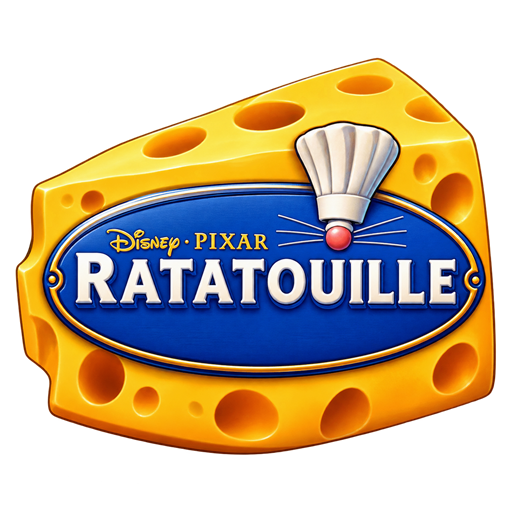

# Ratatouille PC

**By NyxBorn**

<a href="https://recompstore.com/dev/miguel0827"><picture><source media="(prefers-color-scheme: dark)" srcset="https://recompstore.com/assets/press/verified-light.svg"></picture></a>

**[Download the latest version](https://github.com/Miguel0827/Ratatouille-PC/releases/latest)** (Windows `.zip` or Linux `.tar.gz`) · [Report a problem](https://github.com/Miguel0827/Ratatouille-PC/issues/new)

| | |
|---|---|
| 🖥️ **Native** | The game's own code runs as a real PC program: no emulator |
| 📺 **16:9 widescreen** | Always on, on both discs |
| ✨ **480p** | Progressive picture, no interlacing |
| 🔍 **Up to 4x resolution** | Sharper than the console, with the original art |
| ⏸️ **Quick menu (F1)** | Resolution, picture, vertical sync, keys, quick save/load |
| 🐧 **Windows and Linux** | Installer with a progress bar, desktop shortcut, saves folder |
| 💿 **Your own disc** | Nothing of the game is included: it is converted from your ISO |

Native PC port of *Disney·Pixar Ratatouille* (PlayStation 2) built with [ps2-native-recomp](https://github.com/exoteric33/ps2-native-recomp): the game's own code is translated to C++ and compiled for Windows or Linux **on your PC, from your own disc**. This project contains **no game code, no game data and no disc images**.

*Port nativo para PC de Ratatouille (PS2). El juego se convierte en tu PC a partir de tu propia copia. Este proyecto no contiene nada del juego.* (Español abajo.)

## What you need

- **Windows** 10/11 64-bit, or **Linux** 64-bit (see [Linux](#linux)), and an internet connection for the first install (on Windows about 1 GB of tools is downloaded).
- An ISO you made from **your own** Ratatouille PS2 disc. Supported:
  - **Europe (Spain / Portugal)** — SLES-54747 (Spanish, Portuguese)
  - **USA** — SLUS-21541 (English)
- A graphics card with Vulkan (or Direct3D 12 on Windows).

## Use (Windows)

1. Download the Windows zip from the [latest release](https://github.com/Miguel0827/Ratatouille-PC/releases/latest) and extract it to a short folder **outside OneDrive**, for example `C:\Games\Ratatouille`.
2. Open **`Ratatouille PC - Config.exe`** (installing and settings).
3. Click **Import ISO...** and choose your ISO. The installer downloads the converter, applies this project's fixes and converts the game. It takes several minutes the first time. At the end it offers a desktop shortcut.
4. Choose your settings and press **PLAY**. Once installed, **`Ratatouille PC.exe`** appears next to it and goes straight into the game.

In the game, **F1** opens the quick menu (resolution, picture, vertical sync, keys, quick save/load). The game asks for its language when it starts.

## Linux

Download the Linux `.tar.gz` and extract it (`tar xzf ...`). It works like on Windows, with windows (zenity) on a desktop:

1. Install what the build needs, once:
   - Debian / Ubuntu / Mint: `sudo apt install clang libc++-dev libc++abi-dev cmake ninja-build python3 libsdl2-dev git curl unzip pkg-config zenity`
   - Fedora: `sudo dnf install clang libcxx-devel libcxxabi-devel cmake ninja-build python3 SDL2-devel git curl unzip pkgconf zenity`
   - Arch: `sudo pacman -S clang libc++ cmake ninja python sdl2 git curl unzip pkgconf zenity`
2. Run **`linux/config.sh`** (the settings window). The first time it asks for your ISO and installs the game with a progress bar; at the end it offers a desktop shortcut.
3. From then on, **Ratatouille** in your applications menu (or `linux/play.sh`) goes straight into the game; **Ratatouille - Config** changes the settings.

From a terminal: `./linux/install.sh your-game.iso`, then `./linux/play.sh` (options `--scale 1-4`, `--window`; see `--help`).

## What this project adds

- **The game gets past its first frame**: at start it calls 95 start-up functions (C++ constructors) through a list the converter cannot see in the code. Their addresses, read once from each disc (`patches/ratatouille_eu.entries`, `patches/ratatouille_us.entries`), are given to the converter as entry points.
- **Widescreen and 480p on the USA disc too**: PCSX2 has patches only for the European disc. `patches/ratatouille-usa.pnach` moves them to the places the same code and variable have on the USA disc.
- The converter fixes shared with [Crash Bandicoot: The Wrath of Cortex PC](https://github.com/Miguel0827/Crash-Wrath-of-Cortex-PC) and [Crash Tag Team Racing PC](https://github.com/Miguel0827/Crash-Tag-Team-Racing-PC) (`patches/ratatouille-fixes.patch`, made for commit `5d1ebbcf133c`): disc seek callbacks, drawing-queue freeze fix, vector unit programs no longer recompiled every frame, **quick menu (F1)** in English and Spanish in a purple pixel-art style with a **vertical sync** option, and the game's icon on its window.

The launcher (`tools/Launcher.ps1`) and installer (`tools/Instalar.ps1`) are in English, Spanish, French, German, Italian and Portuguese; the Linux windows (`linux/`) in English and Spanish. The converter is downloaded from this project's own copy ([Miguel0827/ps2-native-recomp](https://github.com/Miguel0827/ps2-native-recomp)), with the original repository as a fallback.

Patches from the PCSX2 community (downloaded during install from [PCSX2/pcsx2_patches](https://github.com/PCSX2/pcsx2_patches), not included here): 16:9 widescreen and 480p mode by PeterDelta, always on.

## Where things go

Everything stays in this folder: the installer creates **`engine/`** next to `tools/` with the converter, its tools (~1 GB) and your converted games, saves and settings. `engine/` is listed in `.gitignore`; delete it before sharing or uploading this folder.

Your saves: the **`Partidas`** folder next to the programs leads to them (`memcard.ps2` is the memory card, `states` the quick saves); the note inside says which file is which. Importing the ISO again keeps them.

## Troubleshooting

- **"Este disco no es una versión soportada"** (this disc is not a supported version): only the Europe (SLES-54747) and USA (SLUS-21541) discs are supported.
- **"No se pudo descargar..."** (could not download): the first install needs an internet connection.
- **The game is slow or the picture tears**: lower **Internal resolution**, switch **Vertical sync**, or try the other **Graphics API** (Vulkan / Direct3D 12).
- **Installer log**: `%TEMP%\ratatouille-pc-install.log` on Windows, `/tmp/ratatouille-pc-install.log` on Linux. Attach it when you report a problem.

## Do not share

Do not share ISOs, the converted program (`ps2run.exe` and the generated C++), or saves. They contain the game, which belongs to its owners.

## Reporting problems

[Open an issue](https://github.com/Miguel0827/Ratatouille-PC/issues/new) and say which disc version you have, Windows or Linux, and what graphics card you use. If the installation failed, attach the installer log.

## Credits and licences

- [ps2-native-recomp](https://github.com/exoteric33/ps2-native-recomp) © Samir Nuri and exoteric33, MIT licence. The fixes in `patches/` are under the same licence.
- Launcher, installer and fixes: **NyxBorn**, MIT licence (`LICENSE`).
- PCSX2 patches: PeterDelta.
- Ratatouille © Disney/Pixar. The PS2 game was published by THQ and made by Heavy Iron Studios. This is an unofficial fan project, not affiliated with or endorsed by them.

---

## Español

**Windows:**

1. Descarga el zip de Windows de la [última versión](https://github.com/Miguel0827/Ratatouille-PC/releases/latest) y descomprímelo en una carpeta corta, **fuera de OneDrive**, por ejemplo `C:\Juegos\Ratatouille`.
2. Abre **`Ratatouille PC - Config.exe`** (instalar y configurar).
3. Pulsa **Importar ISO...** y elige la ISO de **tu propio disco** (Europa SLES-54747, en español y portugués, o USA SLUS-21541). La primera vez tarda varios minutos: descarga el convertidor, aplica los arreglos de este proyecto y convierte el juego. Al terminar ofrece un acceso directo en el escritorio.
4. Elige la configuración y pulsa **JUGAR**. Ya instalado, aparece **`Ratatouille PC.exe`**, que abre el juego directamente.

**Linux:** descarga el `.tar.gz`, descomprímelo, instala lo necesario (comando de arriba, sección *Linux*) y abre **`linux/config.sh`**: pide tu ISO, instala el juego con barra de progreso y ofrece un acceso directo. Después el juego aparece en tu menú de aplicaciones como **Ratatouille**.

En el juego, **F1** abre el menú rápido. El idioma se elige al empezar el juego; la versión europea trae español.

Todo queda en esta carpeta: el instalador crea **`engine`** con el convertidor, sus herramientas y tus juegos convertidos, partidas y configuración. Bórrala antes de compartir o subir la carpeta. Tus partidas: la carpeta **`Partidas`**, junto a los programas, lleva a ellas.

No compartas ISOs ni el juego convertido: contienen el juego, que es de sus dueños.

---

### Support my work · Apoya mi trabajo 💜

This port is free and always will be. If you want to support my work as a developer, you can sponsor me on GitHub.
It's completely optional: it doesn't unlock anything and it doesn't pay for the game. You always need your own disc.

*Este port es gratis y siempre lo será. Si quieres apoyar mi trabajo como desarrollador, puedes patrocinarme en GitHub.
Es totalmente opcional: no desbloquea nada y no paga el juego. Siempre necesitas tu propio disco.*

